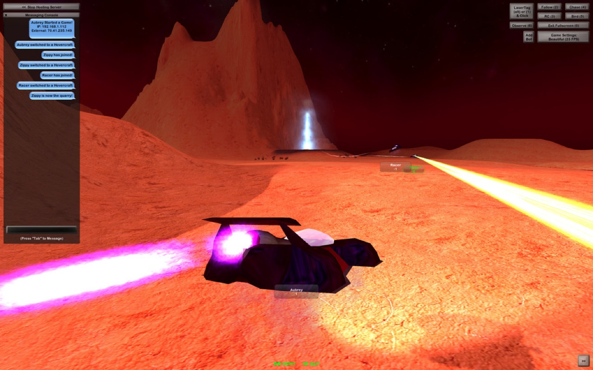
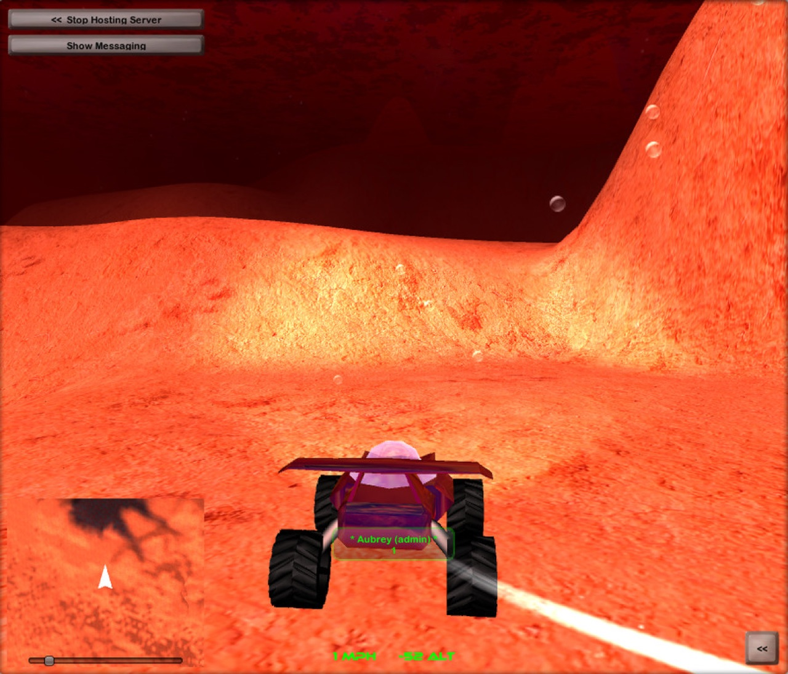

# Mars Explorer

Mars Explorer was a freeform vehicular adventure for macOS and the Dashboard, originally released more than a decade ago. This repository preserves its open-source Unity project and is home to an experimental port for current macOS and Apple silicon.

Original project: [MarsXPLR.com](http://MarsXPLR.com)

## About the original

Aubrey Falconer built Mars Explorer in 2008: flying cars, giant volcanoes and laser tag across player-made worlds called Whirlds. It drew over a million players before retiring in June 2015, a few months after its source was opened. The original repository, [terran-labs/unity3d-marsxplr](https://github.com/terran-labs/unity3d-marsxplr), is now archived; its README tells the full story.

<p align="center">
  
  
</p>

| Folder | Unity version |
| --- | --- |
| `unity/` | 4.6.1f1, the original game |
| `Mars Explorer - Unity 5 Compatibility Fix/` | 5.0.0f4, the community Unity 5 port (original repository pull request #1) |

## Project status

The modern port is under active development and does not yet provide a supported release build. The immediate target is an original-faithful single-player vertical slice that runs natively on Apple silicon without Rosetta.

Current work includes:

- an offline `Init -> InitGame -> Game` scene path;
- a playable temporary buggy controller and generated buggy visual;
- replacement C# components for core camera, HUD, messaging, minimap, world, and game behaviour;
- placeholder quarry and laser interactions;
- repeatable scene-repair and baseline-validation tools.

The vehicle physics, representative world loading, combat loop, and end-to-end macOS build remain incomplete. Multiplayer and retired online services are deliberately deferred.

## Repository layout

- `Unity6/` — canonical modern runtime project, targeting Unity 6.3 LTS (`6000.3.27f1`).
- `tools/` — command-line helpers, including an editor-free C# compile check.
- `unity/` — the original game (Unity 4.6.1f1) and the primary behavioural and asset reference.
- `graphics/` — original supporting graphics.
- `PLAN.md` — implementation roadmap, verification status, and prioritised next work.
- `docs/` — detailed findings and measurements by area (buggy, flight, world and rendering, validation, release, measuring the original).

`Unity5/` may exist locally as an ignored asset-conversion bridge: a copy of the upstream `Mars Explorer - Unity 5 Compatibility Fix/` folder (Unity 5.0.0f4). It is not an active gameplay project, and where it differs from `unity/`, `unity/` is authoritative.

## Requirements

- macOS on Apple silicon for the primary development target;
- Unity 6.3 LTS (`6000.3.27f1`) with macOS Build Support;
- Xcode for IL2CPP macOS builds.

The first deliverable targets native macOS `arm64`. A universal `arm64` and `x86_64` player is planned only after the arm64 vertical slice is stable.

## Getting started

1. Open `Unity6/` in Unity `6000.3.27f1`.
2. Open `Assets/_Scenes/Game.unity`.
3. Run `Tools -> MarsXPLR -> Prepare Game Scene Baseline`.
4. Run `Tools -> MarsXPLR -> Validate Project Baseline`.
5. Save the scene if Unity reports repair changes.
6. Enter Play mode from `Assets/_Scenes/Init.unity` to exercise the complete supported flow, or directly from `Game.unity` for focused iteration.

The supported automatic single-player flow is:

```text
Init -> InitGame -> Game
```

`Lobby.unity` is retained as legacy/reference content but is not part of the current offline vertical slice.

## Editor tools

- `Prepare Game Scene Baseline` reapplies replacement components and asset bindings, reports missing scripts in the open scene, and validates the result.
- `Validate Project Baseline` checks the editor version, required scenes and assets, build settings, and active `Game` scene wiring.
- `Run Buggy Handling Probe` (Play mode) drives the buggy through a fixed input script and writes telemetry to `Logs/handling-probe.txt`.
- `Build macOS arm64 Development Player` builds `Build/macOS-arm64/Mars Explorer.app` inside `Unity6/`.

`tools/compile-check.sh` compiles the project's C# scripts against an installed Unity 6 editor's reference assemblies without launching the editor.

These tools reduce manual recovery work, but they do not replace compile, Play mode, or player-build testing.

## Contributing

Read `PLAN.md` for the current implementation order. The project favours staged C# ports of original behaviour over a rewrite or continued tuning of temporary approximations. Changes should preserve Unity `.meta` files and clearly state what was validated in the Unity Editor.
